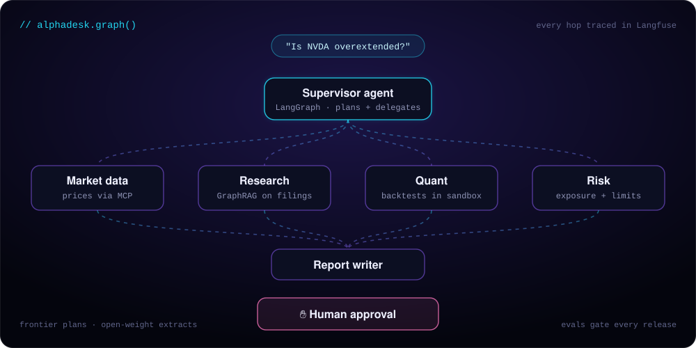

<!-- ============================== HEADER ============================== -->
<p align="center">
  
</p>

<p align="center">
  <a href="https://github.com/Rishikesh32">
    
  </a>
</p>

<p align="center">
  <a href="https://www.linkedin.com/in/rishikesh-ombase-11989b1ab/"></a>
  <a href="mailto:rishikeshombase4@gmail.com"></a>
  <a href="https://rishikesh32.github.io"></a>
  
</p>

---

## 🧠 `whoami`

```python
class Rishikesh(AgenticAIArchitect):
    location        = "Kolhapur, India 🇮🇳"
    experience      = "6+ years in AI & ML · Senior Data Scientist"
    focus           = ["multi-agent systems", "MCP tool layers", "agentic RAG", "LLMOps"]
    currently       = "building AlphaDesk, a multi-agent quant research platform, in public"
    learning        = ["A2A protocol", "agent memory architectures", "eval-driven development"]
    collaborate_on  = ["open-source MCP servers", "agent evaluation tooling", "AI for finance"]
    ask_me_about    = ["LangGraph supervisors", "GraphRAG", "model routing", "guardrails"]
    open_to         = "AI Architect roles 🚀"

    def principles(self):
        return [
            "Workflows before agents",
            "Evals are the spec",
            "Tools through MCP",
            "Humans on the irreversible",
            "Route for cost",
        ]
```

---

## 🛰️ Flagship · AlphaDesk <sub></sub>

<p align="center">
  
</p>

A **multi-agent quant research platform**. A LangGraph supervisor breaks a research question into tasks and delegates to specialists:

| Agent | Job | Built with |
|---|---|---|
| 📈 **Market data** | Pulls prices and fundamentals | MCP servers |
| 📚 **Research** | Reasons over filings and news | GraphRAG · Qdrant · Neo4j |
| 🧮 **Quant** | Writes and runs forecasting and backtest code | Sandboxed code execution |
| 🛡️ **Risk** | Checks exposure and limits | Policy rules + LLM critic |
| ✋ **Human** | Approves before any signal leaves the system | Human-in-the-loop interrupt |

> Frontier models plan, small open-weight models extract. Every run is traced in Langfuse and scored by an eval suite before a release ships.

---

## 🏗️ Agentic architectures

Each one started as a classic ML or automation build that I've redesigned for the agentic era.

| Project | Pattern | Stack | Evolved from |
|---|---|---|---|
| 🛰️ **AlphaDesk** | Hierarchical supervisor | LangGraph · MCP · GraphRAG · Langfuse | Quant stock prediction |
| 🏠 **ListingStudio** | Classify → generate → critique | Vision LLM · LangGraph · batch generation at scale | Real-estate content engine |
| 🧾 **InvoiceOps** | Extract → act + human review | Vision LLM · computer use · Pydantic | Invoice automation (OCR) |
| 📑 **FundDocs Studio** | Multi-agent document pipeline | Vision-language models · LLM agents · style-guide RAG | Mutual fund pipeline |
| 🛸 **SkyWatch** | Perceive → reason → act | YOLO · Qwen-VL · vLLM | Drone recognition (OpenCV) |
| 🎬 **CineMind** | Cluster → rank → serve | User embeddings · clustering · Redis · FastAPI | OTT recommendation backend |
| 🔐 **MCP Gateway** | Secure tool gateway | MCP · OAuth · RBAC · OpenTelemetry | Data integration |

<details>
<summary><b>🔎 Project details (click to expand)</b></summary>
<br>

**📑 FundDocs Studio.** Prospectuses, summary prospectuses and SAI documents go in alongside the client's style guide. Vision-language models read the layout of every page, a style-guide agent decides which rule applies to each heading, table and footnote, and LLM agents apply the formatting and verify it against the guide before a person signs off.

**🎬 CineMind.** The recommendation backend for an OTT platform:
- Watch events become user embeddings, clustered into taste groups so viewers with similar habits are shown similar films
- Candidates come from the viewer's cluster plus item similarity, then a ranker personalises the list
- Redis serves precomputed recommendations, sessions and trending lists for fast reads
- FastAPI microservices on PostgreSQL, packaged with Docker, with a conversational agent that explains each pick

**🏠 ListingStudio.** It goes beyond tagging photos. Vision models classify every image by room and feature, then LLM agents generate the rest of each listing at scale: the view and surroundings, amenities, neighbourhood details and the full description. A critic agent checks every claim before publishing.

</details>

<details>
<summary><b>📐 My reference architecture (click to expand)</b></summary>
<br>

```text
 ┌──────────────┐  ┌──────────────────────────────────────────────────┐  ┌──────────────┐
 │  SECURITY &  │  │ Interfaces      chat · API · Slack/Teams · voice │  │ OBSERVABILITY│
 │  GOVERNANCE  │  │ Guardrails      input validation · policy · out  │  │   & EVALS    │
 │              │  │ Orchestration   supervisor · LangGraph · ✋ HITL │  │              │
 │ identity/RBAC│  │ Specialists     planner · researcher · critic    │  │ Langfuse     │
 │ PII redaction│  │ Tools via MCP   APIs · DBs · browser · sandbox   │  │ eval suites  │
 │ injection def│  │ Knowledge       vector + graph RAG · memory      │  │ cost budgets │
 │ audit trail  │  │ Model gateway   routing · frontier · vLLM · cache│  │ drift alerts │
 └──────────────┘  └──────────────────────────────────────────────────┘  └──────────────┘
```

</details>

---

## 🧰 Tech stack

**Agents & orchestration**


**Models**


**Knowledge & memory**


**LLMOps & governance**


**Platform & cloud**

<p>
  
</p>


---

## 💼 Experience

| When | Role | Where |
|---|---|---|
| **Dec 2023 — now** | Senior Data Scientist: LLM-integrated API services and GenAI modules for financial reports | AIT Global India |
| **Jul 2023 — Oct 2023** | AI Data Specialist: real-time data for pricing models | Futurense Technologies |
| **Jul 2022 — Mar 2023** | Software Engineer: systems for large-scale trading data | Systech Solutions |
| **Jan 2020 — Mar 2022** | Data Scientist: stock-movement models and alpha signals | Varilligence Technologies |

🎓 M.Sc. Computer Science, Shivaji University · 🏆 Best Performer of the Month · Spot Award · GOM Award

---

## 📊 GitHub activity

<p align="center">
  
  
</p>

<p align="center">
  
</p>

<p align="center">
  
</p>

<!-- Snake animation: generated daily by .github/workflows/snake.yml -->
<p align="center">
  <picture>
    <source media="(prefers-color-scheme: dark)" srcset="https://raw.githubusercontent.com/Rishikesh32/Rishikesh32/output/github-snake-dark.svg">
    <source media="(prefers-color-scheme: light)" srcset="https://raw.githubusercontent.com/Rishikesh32/Rishikesh32/output/github-snake.svg">
    
  </picture>
</p>

---

<p align="center">
  <b>Building something agentic? Let's talk.</b><br>
  <a href="mailto:rishikeshombase4@gmail.com">rishikeshombase4@gmail.com</a> ·
  <a href="https://www.linkedin.com/in/rishikesh-ombase-11989b1ab/">LinkedIn</a>
</p>

<p align="center">
  
</p>
